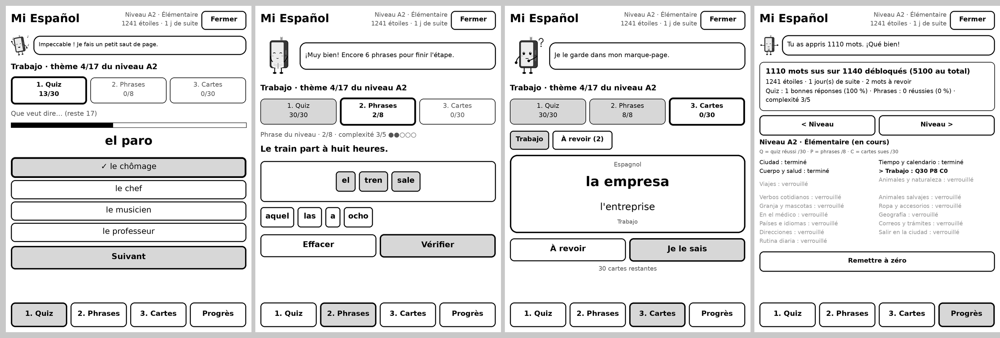

# Plugins KOReader en français pour Kobo Libra Colour

Des petites applications qui tournent **directement sur la liseuse**, sans connexion internet, dans [KOReader](https://koreader.rocks).

## Mi Español : apprendre l'espagnol sur sa liseuse

- **5 100 mots** en espagnol avec leur traduction en français
- **10 niveaux**, du débutant (A1) à la maîtrise (C2), et 170 thèmes de 30 mots
- Chaque thème se fait en 3 étapes : **Quiz**, puis **Phrases** à reconstruire, puis **Cartes**
- Quand un thème est fini, les 30 mots suivants se débloquent tout seuls
- Les phrases deviennent plus longues après 5 réussites d'affilée
- Les mots ratés reviennent dans une pile « À revoir »
- **Kobi**, un petit robot en forme de liseuse, réagit à tes réponses et t'encourage
- La progression est enregistrée sur la liseuse

### Installation

1. Télécharge **[MiEspanol-KOReader.zip](MiEspanol-KOReader.zip)** (bouton « Download raw file ») et dézippe-le.
2. Branche ta Kobo à l'ordinateur avec le câble USB et touche « Connecter ».
3. Copie le dossier `espanol.koplugin` dans `.adds/koreader/plugins/` sur la liseuse.
   Le dossier `.adds` est caché : sur Mac, appuie sur Cmd + Maj + point ; sur Windows, Affichage > Afficher > Éléments masqués.
4. Éjecte la liseuse et redémarre KOReader.
5. Dans KOReader : touche le haut de l'écran > icône **Outils** (la clé) > **Mi Español**, en bas de la première page.

KOReader doit déjà être installé sur la liseuse.

### Sauvegarde

La progression est enregistrée dans `.adds/koreader/settings/espanol.lua`.
Pour mettre à jour l'app, remplace simplement le dossier `espanol.koplugin` : la progression n'est pas effacée.

### Retours

Tu as trouvé une erreur de traduction ou un bug ? Ouvre une *issue* sur cette page.
